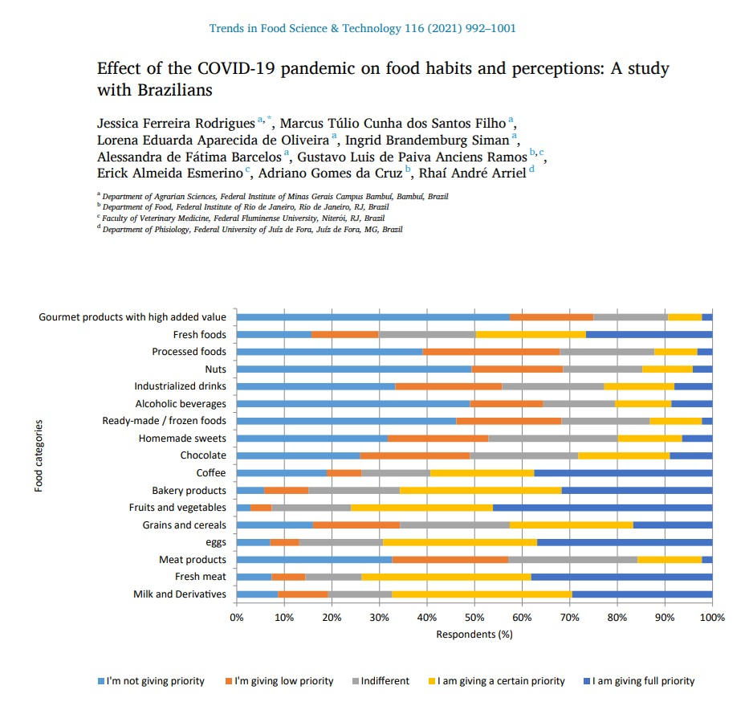
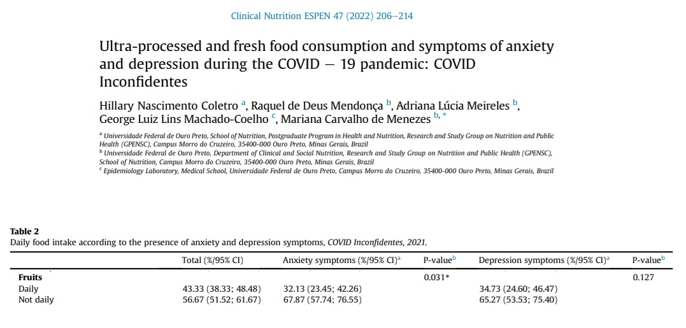

## Introdução

-   **Contextualização:**


## Objetivos


- Avaliar a associação entre características sociodemográficas, econômicas, antropométricas e comportamentais na **mudança de consumo de frutas** no contexto da pandemia de COVID-19. 

- Explorar, de forma integrada, possíveis fatores associados às alterações de hábitos alimentares e comportamentais observadas durante a pandemia.

## Metodologia

- **Questionário:** 2155 respostas coletadas de forma online por alunas de pós-graduação da Nutrição da UFF, em 2022.
- **Variável resposta:** Mudança no consumo de frutas (Aumentou, Diminuiu, Não alterou).
- **Variáveis categóricas:** Gênero, Raça/Cor, Região, Isolamento, Situação de trabalho, Renda familiar, Escolaridade, Diagnóstico de COVID-19, Consulta com nutricionista, Dificuldade financeira, Hábito de fumar, Ansiedade, Depressão, Insônia, e Enxaqueca.
- **Variáveis quantitativas:** Idade, Peso, Altura, e IMC.

## Metodologia


- **Análises das variáveis categóricas:** teste qui-quadrado de independência ou teste exato de Fisher (<5).
- **Análises das variáveis quantitativas:** Análise da normalidade e homogeneidade das variâncias. ANOVA Clássica ou ANOVA de Welch. Teste post-hoc: Games-Howell. 
- Significância estatística com p< 0,05.

## Resultados {.scrollable}

-   **Variáveis Categóricas**

```{r}
library(gtsummary)
library(gt)
library(openxlsx)
library(rstatix)

theme_gtsummary_language("pt", big.mark = ".", decimal.mark = ",")

dados <- read.xlsx("C:/Users/Dell/OneDrive/Documentos/Projeto1/Nutrição.xlsx")

dados$Renda_familiar <- factor(
  dados$Renda_familiar,
  levels = c(
    "até R$ 1254,00",
    "entre R$ 1.255 - R$ 8.640",
    "mais de R$ 8.640"
  )
)

dados$Escolaridade <- factor(
  dados$Escolaridade,
  levels = c(
    "Analfabeto",
    "Ensino Fundamental Completo",
    "Ensino Médio Completo",
    "Ensino Superior Completo",
    "Pós-graduação",
    "Não desejo informar"
  )
)

dados$Raca_cor <- factor(
  dados$Raca_cor,
  levels = c(
    "Amarela",
    "Branca",
    "Indígena",
    "Parda",
    "Preta",
    "Outro",
    "Prefiro não declarar"
  )
)

dados$Regiao <- factor(
  dados$Regiao,
  levels = c(
    "Norte",
    "Nordeste",
    "Centro-oeste",
    "Sudeste",
    "Sul"
  )
)


DadosQuali = dados %>% select(Genero, Raca_cor, Regiao,
                              Isolamento, Trabalha,
                              Renda_familiar, Escolaridade,
                              Covid, Consulta_Nutricionista,
                              Dificuldade_Financeira,
                              cigarro, Ansiedade, Depressao,
                              Insonia, Enxaqueca, Frutas)

# Função que calcula o coeficiente de Cramer
cramer_fun <- function(data, variable, by, ...) {
  tab <- table(data[[variable]], data[[by]])
  v <- cramer_v(tab)
  tibble::tibble(`**Cramér**` = round(v, 3))
}

# Investigando valores esperados

# chisq.test(dados$Genero,dados$Frutas)$expected
# 
# chisq.test(dados$Raca_cor,dados$Frutas)$expected
# 
# chisq.test(dados$Regiao,dados$Frutas)$expected
# 
# chisq.test(dados$Isolamento,dados$Frutas)$expected
# 
# chisq.test(dados$Trabalha,dados$Frutas)$expected
# 
# chisq.test(dados$Renda_familiar,dados$Frutas)$expected
# 
# chisq.test(dados$Escolaridade,dados$Frutas)$expected
# 
# chisq.test(dados$Covid,dados$Frutas)$expected
# 
# chisq.test(dados$Consulta_Nutricionista,dados$Frutas)$expected
# 
# chisq.test(dados$Dificuldade_Financeira,dados$Frutas)$expected
# 
# chisq.test(dados$cigarro,dados$Frutas)$expected
# 
# chisq.test(dados$Ansiedade,dados$Frutas)$expected
# 
# chisq.test(dados$Depressao,dados$Frutas)$expected
# 
# chisq.test(dados$Insonia,dados$Frutas)$expected
# 
# chisq.test(dados$Enxaqueca,dados$Frutas)$expected
# 
# # Investigando resíduos
# 
# chisq.test(dados$Raca_cor,dados$Frutas)$stdres
# 
# chisq.test(dados$Isolamento,dados$Frutas)$stdres
# 
# chisq.test(dados$Trabalha,dados$Frutas)$stdres
# 
# chisq.test(dados$Renda_familiar,dados$Frutas)$stdres
# 
# chisq.test(dados$Escolaridade,dados$Frutas)$stdres
# 
# chisq.test(dados$Consulta_Nutricionista,dados$Frutas)$stdres
# 
# chisq.test(dados$Dificuldade_Financeira,dados$Frutas)$stdres
# 
# chisq.test(dados$Ansiedade,dados$Frutas)$stdres
# 
# chisq.test(dados$Depressao,dados$Frutas)$stdres
# 
# chisq.test(dados$Insonia,dados$Frutas)$stdres
# 
# chisq.test(dados$Enxaqueca,dados$Frutas)$stdres

# Código da tabela

tbl_summary(data = DadosQuali,
            by = Frutas,
            percent = "row",
            label = list(
              Genero ~ "Gênero<sup>F</sup>",
              Raca_cor ~ "Raça/cor<sup>F</sup>",
              Regiao ~ "Região<sup>Q</sup>",
              Isolamento ~"Isolamento<sup>Q</sup>",
              Trabalha ~ "Trabalha<sup>Q</sup>",
              Renda_familiar ~ "Renda familiar<sup>Q</sup>",
              Escolaridade ~ "Escolaridade<sup>F</sup>",
              Covid ~ "COVID-19<sup>Q</sup>",
              Consulta_Nutricionista ~ "Consulta com nutricionista<sup>Q</sup>",
              Dificuldade_Financeira ~ "Dificuldade financeira<sup>Q</sup>",
              cigarro ~ "Cigarro<sup>Q</sup>",
              Ansiedade ~ "Ansiedade<sup>Q</sup>",
              Depressao ~ "Depressão<sup>Q</sup>",
              Insonia ~ "Insônia<sup>Q</sup>",
              Enxaqueca ~ "Enxaqueca<sup>Q</sup>"
            )
)%>%
  add_p(pvalue_fun = label_style_pvalue(digits = 3),
        test = list(
          c(Genero, Raca_cor, Escolaridade) ~ "fisher.test",
          c(Regiao, Isolamento, Trabalha, Renda_familiar,
            Covid, Consulta_Nutricionista,
            Dificuldade_Financeira, cigarro, Ansiedade,
            Depressao, Insonia, Enxaqueca) ~ "chisq.test"),
        test.args = list(
          c(Genero, Raca_cor, Escolaridade) ~ list(simulate.p.value = TRUE)
        )) %>%
  bold_p(t = 0.05) %>%
  add_stat(fns = everything() ~ cramer_fun)%>%
  modify_spanning_header(all_stat_cols() ~ "**Consumo de frutas**") %>%
  modify_header(label ~ "**Variáveis**") %>%
  bold_labels() %>%
  modify_header(all_stat_cols() ~ "**{level}**<br>{n} ({style_percent(p)}%)") %>%
# modify_bold(
#   columns = stat_2,  # segunda coluna
#   rows = (variable == "Raca_cor" & label == "Nenhum dia")
# )%>%
# modify_bold(
#   columns = stat_2,  # segunda coluna
#   rows = (variable == "Saude_Mental" & label == "Nenhum dia")) %>%
modify_footnote(everything() ~ NA)%>%
as_gt() %>%
  tab_style(
    style = cell_fill(color = "#d4edda"), # Soft light green
    locations = cells_body(
      columns = stat_2,
      rows = which(
        (variable == "Raca_cor" & label == "Preta") |
        (variable == "Trabalha" & label == "Não") |
        (variable == "Renda_familiar" & label == "até R$ 1254,00") |
        (variable == "Escolaridade" & label == "Ensino Médio Completo") |
        (variable == "Consulta_Nutricionista" & label == "Não") |
        (variable == "Dificuldade_Financeira" & label == "Sim") |
        (variable == "Ansiedade" & label == "Sim") |
        (variable == "Depressao" & label == "Sim") |
        (variable == "Insonia" & label == "Sim") |
        (variable == "Enxaqueca" & label == "Sim")
      )
    )
  ) %>%
  tab_style(
    style = cell_fill(color = "#d4edda"), # Soft light green
    locations = cells_body(
      columns = stat_1,
      rows = which(
        (variable == "Renda_familiar" & label == "mais de R$ 8.640") |
        (variable == "Escolaridade" & label == "Pós-graduação") |
        (variable == "Consulta_Nutricionista" & label == "Sim") |
        (variable == "Dificuldade_Financeira" & label == "Não") |
        (variable == "Depressao" & label == "Não") |
        (variable == "Insonia" & label == "Não")
      )
    )
  ) %>%
  tab_style(
    style = cell_fill(color = "#d4edda"), # Soft light green
    locations = cells_body(
      columns = stat_3,
      rows = which(
        (variable == "Raca_cor" & label == "Branca") |
        (variable == "Isolamento" & label == "Não") |
        (variable == "Renda_familiar" & label == "mais de R$ 8.640") |
        (variable == "Dificuldades_financeiras" & label == "Não") |
        (variable == "Ansiedade" & label == "Não") |
        (variable == "Depressao" & label == "Não") |
        (variable == "Enxaqueca" & label == "Não")
      )
    )
  ) %>%
  tab_style(
    style = cell_fill(color = "#f8d7da"), # Soft light red
    locations = cells_body(
      columns = stat_1,
      rows = which(
        (variable == "Renda_familiar" & label == "até R$ 1254,00") |
        (variable == "Escolaridade" & label == "Ensino Médio Completo") |
        (variable == "Consulta_Nutricionista" & label == "Não") |
        (variable == "Dificuldade_Financeira" & label == "Sim") |
        (variable == "Depressao" & label == "Sim") |
        (variable == "Insonia" & label == "Sim")
      )
    )
  ) %>%
  tab_style(
    style = cell_fill(color = "#f8d7da"), # Soft light red
    locations = cells_body(
      columns = stat_2,
      rows = which(
        (variable == "Raca_cor" & label == "Branca") |
        (variable == "Trabalha" & label == "Sim") |
        (variable == "Renda_familiar" & label == "mais de R$ 8.640") |
        (variable == "Escolaridade" & label == "Pós-graduação") |
        (variable == "Consulta_Nutricionista" & label == "Sim") |
        (variable == "Dificuldade_Financeira" & label == "Não") |
        (variable == "Ansiedade" & label == "Não") |
        (variable == "Depressao" & label == "Não") |
        (variable == "Insonia" & label == "Não") |
        (variable == "Enxaqueca" & label == "Não")
      )
    )
  ) %>%
  tab_style(
    style = cell_fill(color = "#f8d7da"), # Soft light red
    locations = cells_body(
      columns = stat_3,
      rows = which(
        (variable == "Raca_cor" & label == "Preta") |
        (variable == "Isolamento" & label == "Sim") |
        (variable == "Renda_familiar" & label == "até R$ 1254,00") |
        (variable == "Dificuldades_financeiras" & label == "Sim") |
        (variable == "Ansiedade" & label == "Não") |
        (variable == "Depressao" & label == "Sim") |
        (variable == "Enxaqueca" & label == "Sim")
      )
    )
  ) %>%
fmt_markdown(columns = label) %>%
tab_options(
  table.font.size = "20px",
  heading.title.font.size = "26px",
  column_labels.font.size = "22px"
  ) 


```

## Resultados {.scrollable}

-   **Variáveis Quantitativas**

```{r}
library(gtsummary)
library(gt)
library(ggplot2)
library(qqplotr)
library(car)

DadosQuanti = dados %>% 
  select(Idade,Peso,Altura, IMC, Frutas)

# ggplot(DadosQuanti, aes(x = Idade)) +
#   geom_density(fill = "blue", alpha = 0.6) +
#   facet_wrap(~ Frutas) +
#   xlab("Idade") +
#   ylab("Densidade") +
#   theme_bw() +
#   theme(text = element_text(size = 14))
# 
# ggplot(DadosQuanti, aes(sample = Idade)) +
#     stat_qq_band(fill="lightblue") +
#     stat_qq_line() +
#     stat_qq_point() +
#     facet_wrap(~Frutas,scales = "free")+
#     xlab("Quantis Teoricos")+
#     ylab("Quantis Amostrais")+
#     theme_bw() +
#     theme(text = element_text(size = 14))
# 
# by(DadosQuanti$Idade, DadosQuanti$Frutas, shapiro.test)
# 
# ggplot(DadosQuanti, aes(x = Peso)) +
#   geom_density(fill = "blue", alpha = 0.6) +
#   facet_wrap(~ Frutas) +
#   xlab("Peso") +
#   ylab("Densidade") +
#   theme_bw() +
#   theme(text = element_text(size = 14))
# 
# ggplot(DadosQuanti, aes(sample = Peso)) +
#     stat_qq_band(fill="lightblue") +
#     stat_qq_line() +
#     stat_qq_point() +
#     facet_wrap(~Frutas,scales = "free")+
#     xlab("Quantis Teoricos")+
#     ylab("Quantis Amostrais")+
#     theme_bw() +
#     theme(text = element_text(size = 14))
# 
# by(DadosQuanti$Peso, DadosQuanti$Frutas, shapiro.test)
# 
# ggplot(DadosQuanti, aes(x = Altura)) +
#   geom_density(fill = "blue", alpha = 0.6) +
#   facet_wrap(~ Frutas) +
#   xlab("Altura") +
#   ylab("Densidade") +
#   theme_bw() +
#   theme(text = element_text(size = 14))
# 
# ggplot(DadosQuanti, aes(sample = Altura)) +
#     stat_qq_band(fill="lightblue") +
#     stat_qq_line() +
#     stat_qq_point() +
#     facet_wrap(~Frutas,scales = "free")+
#     xlab("Quantis Teoricos")+
#     ylab("Quantis Amostrais")+
#     theme_bw() +
#     theme(text = element_text(size = 14))
# 
# by(DadosQuanti$Altura, DadosQuanti$Frutas, shapiro.test)
# 
# ggplot(DadosQuanti, aes(x = IMC)) +
#   geom_density(fill = "blue", alpha = 0.6) +
#   facet_wrap(~ Frutas) +
#   xlab("IMC") +
#   ylab("Densidade") +
#   theme_bw() +
#   theme(text = element_text(size = 14))
# 
# ggplot(DadosQuanti, aes(sample = IMC)) +
#     stat_qq_band(fill="lightblue") +
#     stat_qq_line() +
#     stat_qq_point() +
#     facet_wrap(~Frutas,scales = "free")+
#     xlab("Quantis Teoricos")+
#     ylab("Quantis Amostrais")+
#     theme_bw() +
#     theme(text = element_text(size = 14))
# 
# by(DadosQuanti$IMC, DadosQuanti$Frutas, shapiro.test)
# 
# # Teste de Levene (variâncias)
# 
# leveneTest(Idade ~ Frutas , data = DadosQuanti)
# 
# leveneTest(Peso ~ Frutas , data = DadosQuanti)
# 
# leveneTest(Altura ~ Frutas , data = DadosQuanti)
# 
# leveneTest(IMC ~ Frutas , data = DadosQuanti)


# games_howell_test(Idade~Frutas,
#                   data=DadosQuanti)

comparacoes_letras <- function(data, variable, by, ...) {
  letras <- data.frame(
    variavel = c("Idade", "Peso",
                 "Altura", "IMC"),
    comparacao = c(
      "Aumentou = a<br>Diminuiu = b<br>Não alterou = a",
      "Aumentou = a<br>Diminuiu = a<br>Não alterou = a",
      "Aumentou = a<br>Diminuiu = a<br>Não alterou = a",
      "Aumentou = a<br>Diminuiu = a<br>Não alterou = a"
    ),
    stringsAsFactors = FALSE  
  )
  result <- letras$comparacao[letras$variavel == variable]
  tibble::tibble(`**Comparações Múltiplas**` = result)
}

tbl_summary(
  data = DadosQuanti,
  by = Frutas,
  label = list(
              Idade ~ "Idade<sup>W</sup>",
              Peso ~ "Peso<sup>W</sup>",
              Altura ~ "Altura<sup>C</sup>",
              IMC ~"IMC<sup>W</sup>"),
  statistic = all_continuous() ~ "{mean} ({sd})"
) |>
  add_p(pvalue_fun = label_style_pvalue(digits = 3),
    test = everything() ~ "oneway.test",
    test.args = list(
      c(Idade, Peso, IMC) ~ list(var.equal = F),   
      Altura ~ list(var.equal = T)  
    )
  ) %>%
  bold_p(t = 0.05) %>%
  modify_spanning_header(all_stat_cols() ~ "**Consumo de frutas**") %>%
  modify_header(label ~ "**Variáveis**") %>%
  bold_labels() %>%
  modify_header(all_stat_cols() ~ "**{level}**<br>{n} ({style_percent(p)}%)") %>%
  modify_footnote(everything() ~ NA)%>%
  add_stat(
    fns = everything() ~ comparacoes_letras,
    location = everything() ~ "label"
  ) %>%
  as_gt() %>%                   
  fmt_markdown(columns = c(label,`**Comparações Múltiplas**`))%>%
  tab_options(
    table.font.size = "20px",    
    heading.title.font.size = "26px",
    column_labels.font.size = "22px"
  )
  
```

## Discussão


- Observou-se associação da mudança do consumo de frutas com raça/cor, isolamento, situação de trabalho, renda familiar, escolaridade, consulta com nutricionista, dificuldade financeira, ansiedade, depressão, insônia, enxaqueca, e idade.

## Discussão



## Discussão


